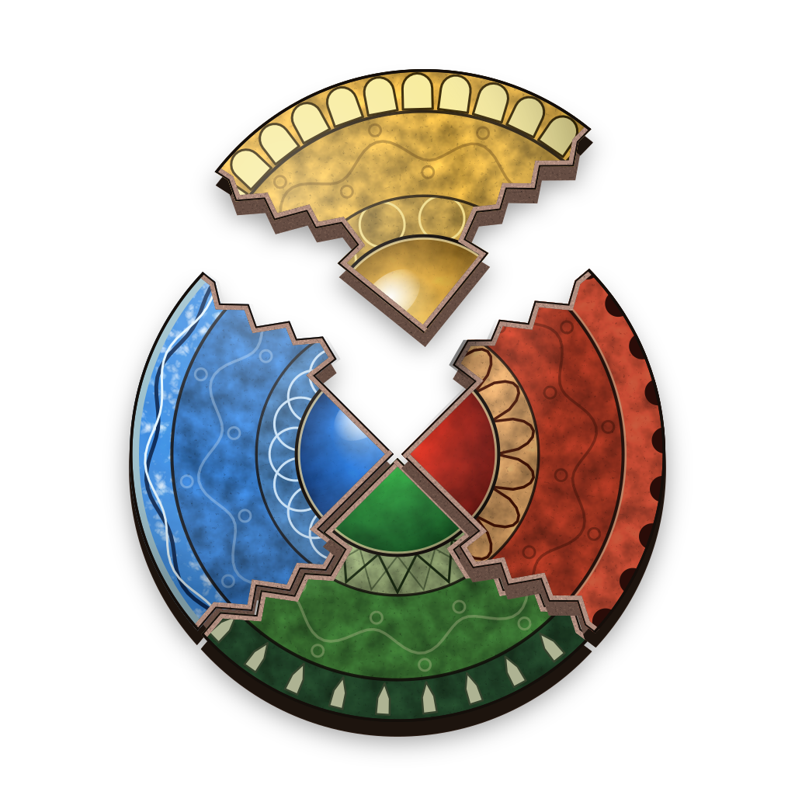

# AzurKit



Patch packs, sliders, a randomizer and character swaps for *Azurik: Rise of
Perathia* (Xbox), built from your own copy of the game.

**Public and in development, not released yet:** there is no release to download (CI keeps each test build of the
apps for 14 days); the website and the first release come with version 1.0, and today you build the macOS app from
source ([Development](#development)).

## Highlights

- **Runs in your browser.** Your game never leaves your computer: nothing is uploaded, and tests check every request.
- **Fixes two of the game's bugs.** A rare crash while a level loads and a "Loading..." hang, both fixed by default.
- **A self-checking randomizer.** Every seed's image is read back against its plan before it is saved.
- **Tracker maps at once.** They show the moment you open the tracker and what you can reach now; in the app, Live
  marks your pickups in xemu.
- **Play as almost anyone.** 178 of the game's 184 creatures, moves and speed fitted to each body, picked by grade
  and seen from front and back before you build.
- **Builds carry their recipe.** Open any AzurKit build to get back the packs, settings and seed that made it.
- **No hard limits.** 17 packs and 47 settings on both USA and Europe, and no setting is ever clamped.
- **Edit the game's data.** Every critter's, item's, armor's and spell's numbers, before you even pick your image.

## Features

### Patches and sliders

- **17 patch packs:** every one works on both releases, USA and Europe, in three groups: Player, Enemies and
  Quality of Life.
- **Frame-rate unlock:** 60 FPS by default, or any whole frame rate up to 1,905, with game time keeping pace.
- **Gravity:** set the world's gravity; your jump and flap heights stay the same.
- **Movement:** walk, jump, swim, climb and roll speed, roll distance, air control, flap height and ceiling, and
  flap fuel costs.
- **Speed toggle:** click the left stick (L3) in game to flip a movement setting between yours and the original.
- **Starting health:** your starting HP and the health bar's full scale.
- **Air shield flaps:** how many wing flaps each air shield tier gives.
- **Damage enemies take:** multipliers for neutral hits, weaknesses and immunities, across all 33 of your attacks.
- **Enemy and boss scaling:** health, damage, attack speed, move speed and size, set apart for enemies and bosses.
- **Save-point warp:** on a save platform, hold LT and press A, B, X, Y to go to town and back.
- **Photo mode:** click both sticks to freeze the game, hide the HUD and fly the camera, slower or faster.
- **Fewer popups:** hide the first-time gem popups, and the tutorial, key, health and power-up ones.
- **Skip the waits:** skip the pickup celebration (the item still counts) and the unskippable Adrenium logo at boot.
- **Crash fix:** on by default, it cures a rare crash in the original game while a level loads.
- **Loading fix:** on by default, it ends a "Loading..." hang at level changes, and a bigger load budget fits a
  larger player model.
- **More RAM in xemu:** on by default: with xemu set to 128 MiB, levels, textures and meshes load past 64 MiB.
  256 MiB is optional.
- **Any number you like:** a setting takes any finite number, never clamped, and its slider widens to hold it.
- **The original values:** each slider shows the game's own value (gravity and the load budget read from your
  copy).
- **Clear refusals:** only a value the game can't hold is refused, and by name.
- **Linked packs:** a pack that needs another ticks it too.
- **Community packs:** ready-made setups from our Azurik-Custom-Content, listed in the Patches tab with Install and
  Update; a ticked one sets its packs and game data for you, every file checked first, and stays at its version until
  you update it. None are published yet.

### Randomizer

- **Your choice of shuffle:** disc fragments, elemental powers, upgrades, gems, obsidians and fuel pickups; keys and
  barriers stay put.
- **Whole-game logic:** all 22 levels and their 1,418 item locations.
- **Movement difficulty:** Standard, Hard or Frame-perfect jumps and flaps.
- **Seed difficulty:** Any, Standard, Hard or Frame-perfect: key items go where the tricks you allowed are needed at
  several points through the game, and the seed stays beatable.
- **36 rated skips:** each on or off, or by group: power storage, roll and flap tricks, barriers, dark rooms,
  out of bounds.
- **Dark areas:** choose whether they need Fire 1, 2 or 3.
- **Obsidian cost:** any number per lock (the game's is 10).
- **Seeds:** any text is a seed, or New draws one; the same seed and settings give the same game everywhere.
- **Share strings and files:** one `AZR-` string holds every setting; settings files save and load,
  Azurik_Modkit's too.
- **Warns before you build** when your settings can't make a seed.
- **Works with movement mods:** the logic is re-checked under your jump and speed settings; anything it can't model
  is flagged.
- **Sealed items stay sealed:** an item placed in an ice or acid block, a gem rock or behind a force field can be
  picked up only once it opens, however wide the item reaches.
- **Character builds share alike:** the body you wear folds its size into the share string, so a seed you track or
  share wearing it is the one its build places.
- **Checked before it's saved:** the finished image is read back against its plan, and any mismatch no later
  change explains stops the build.
- **Logic verdict:** whether the logic still holds, and why not (a pack over an item spot, an unmodelled setting,
  a costlier lock, a worn body).
- **One build:** randomize and patch together, on USA or Europe.
- **Spoiler log:** each sphere, every key item with its way in and its way back, and the traps; view or save it.
  It's written once the build is done, so the build is ready sooner.

### Item tracker

- **Track any seed:** a randomized build (the one you just built, or any you open on the Tools tab: Track this
  build), a seed you haven't built yet, or a plan file.
- **Quick to open:** on our Mac the Randomizer tab opens, and Track this seed shows its plan, within 3 s of the
  click, in the app and in the browser.
- **What a seed needs:** with Seed difficulty on, the head line says how many points need a trick and how hard.
- **Where you stand:** what you've collected and what you can reach right now, sphere by sphere.
- **Skips shown apart:** spots you can reach only with a skip have their own colour.
- **Spoiler-free:** each item stays hidden until you collect it, unless you turn Spoiler on.
- **Maps at once:** 22 level maps, a world map and 41 icons come with AzurKit, so the world map shows the moment you
  open the tracker, before you pick your image or a seed.
- **Level maps:** floors, zoom and pan; click a spot to mark it, or an exit to jump to its level. Each item shows
  on the floor of the room it stands in, and each floor's button shows how many are left on it; the other floors'
  items show faintly, fainter the further the floor. Sharp when zoomed in: 18 levels carry each floor again at 2 px
  a metre, up to 5 times finer.
- **Every lock labelled:** exits, barriers, key locks and disc seals show what they need; save points and
  teleporters are marked.
- **World map:** each level with a badge of the spots you can reach now.
- **Table view:** the same as a list of items and places.
- **Gems:** a coloured dot for each of the 1,215 gem spots, and the gems taken and left on each level.
- **Collected spots leave the map:** Show collected brings them back, dimmed. A pickup Live sees flashes on the map
  and says what you got.
- **Remembers your marks** for your last 20 seeds, never your image; Reset clears them.
- **Live, in the app:** marks what you pick up in a running xemu and shows where you are, with Find me and Follow,
  which switches the map to the floor you stand on.
- **Live only reads:** it never launches xemu, writes to it or pauses the game.
- **Live keeps up:** it finds an xemu started with QMP on port 4444, tells USA from Europe and follows deaths,
  reloads and save states.
- **Live says what's off:** if xemu runs another seed or build, it counts the level's spots that differ and says
  what to check, or that the game isn't randomized.

### Characters

In the page's Characters tab, or from the command line (`azurkit build --character '{"species": "keylord"}'`).

- **Pick by grade:** every creature in its grade's colour and mark, so it reads without colour too: ✓ green fully
  playable, ~ yellow rough edges, ✕ red not playable; the 73 nobody has tested yet are greyed and marked ?, and the
  weapons on them greyed.
- **Any weapon on any model:** all five are listed even before you pick your image, a pick nobody has seen in game says
  (not tested), and Preview shows the weapon in a small popup.
- **Objects tucked away:** the 76 pickups, keys and statues you can wear stay out of the list until you tick Show
  objects (remembered); one you already wear stays listed.
- **See it first:** the chosen model from the front and from behind, at once and before you pick your image; the
  whole list and every weapon show straight away too, and G4 and how a weapon fits say they need your image.
- **Match Garret in one click:** a G4 button beside model size, attack reach, damage and speed sets the body to
  Garret's height, reach, damage per second or timing.
- **Play as almost anyone:** 178 of the game's 184 creatures, bosses to critters, on both releases. The 30
  weaponless townsfolk fight bare-handed, and the air elemental's gust whirls up a tornado; nothing to download.
- **Two ways to play:** the creature's own moves (the default), or Garret's exact moves in its skin.
- **Any size:** the body's own or Garret's height, times any scale you like.
- **Borrowed moves:** Garret's moves fill a body's gaps, fitted onto 36 different skeletons.
- **Speed that fits:** walk and roll speed scale with the body, and the speed toggle flips to its own pace.
- **Weapons:** Garret's Axion staff, the farmer's hoe, Balthazar's magic, the spin attack or bare hands.
- **Attacks:** reach, damage and speed multipliers.
- **Combos on a hit:** a body's combo goes on to its next attack only after a hit, as Garret's does, in every one of
  its attack sets; Chain on any press (off by default, beside Gameplay; `"chain": "any"`) lets any press in the
  window chain instead, for any model.
- **Voice:** the creature's own sounds, or Garret's.
- **Variants:** Beamlord, and Booblord as she is, in high detail, in human colours or both, each a recipe over a
  creature's body applied to your own copy; or your own recipe file, its shapes sized as you like (a moved shape
  shows the nearest one at once, marked Preview, until its own pictures are drawn). Booblord's four
  need her own moves and voice, extra files from our Azurik-Custom-Content; a build without them stops, naming
  the file.
- **Community variants:** ours from Azurik-Custom-Content sit under the species, marked community, with Install
  and Update (or `azurkit content install booblord`); every file's size and checksum is checked first, so a bad
  download keeps nothing, and an installed one stays at its version until you update it. An update only goes up, from
  where it was installed, and a web source is https. In the browser, Booblord's
  pictures and G4 values can run out of memory: the app draws them.
- **Ready-made bodies:** every body's size at its defaults ships with AzurKit, and Booblord's whole build at the
  defaults comes with her download, for both releases, so their first Build skips that work; any other choice builds
  as before.
- **Effects of its own:** a recipe can give its attacks a fireball, ice shard, arrow, bubble, dome, barrier, stream,
  bolts or laser, made from the game's own effects.
- **Works with every pack and the randomizer:** a seed can wear a character, its logic re-checked at the body's
  walk and roll, and the verdict says what the body changes (its height, its attacks).
- **In links and recipes:** a share link and a build's recipe carry the character, by name and numbers; a variant
  whose recipe has changed since is named, with what to install or update.

### Data

In the page's Data tab, in the browser and the app alike, or read from the command line (`azurkit data`). It works
before you pick your image: AzurKit ships the game's original config.xbr, the same on both releases.

- **Views:** the Player, Critters, Items, Armor and Weapons, each entity's numbers from every table that holds them,
  with a search box; All tables, each as a grid you can sort, or show only what you changed.
- **Edit any cell:** any number, never clamped; only a value the game can't store is refused, saying why. Each cell
  has a note on what it does.
- **Marks:** ● on what you changed, with the original value; ⚠ where a ticked pack also writes it (your edit wins,
  and the build says so).
- **Undo and Redo,** Revert a cell, Reset a table, Clear edits. Your edits join each build after the packs, and a
  link, a mods file and the remembered setup keep them.

### Tools

In the page's Tools tab, in the browser and the app alike, or from the command line (`azurkit files`).

- **Your image:** its release, size and kind (original, an AzurKit build with what made it, or modded with the first
  file that differs); greyed until you pick it.
- **Verify every file:** all 1,195 checked against the original disc, with a bar; it reads only what the first
  check left, and asked again it reads nothing.
- **Its files:** the whole list, with a filter; Extract one (the browser downloads it from your own file, the app
  writes it where you choose, never over your image).
- **Recipes and files:** open any AzurKit build for its recipe, load or save a mods file, view or save a plan file's
  spoiler and the last build's report.
- **AzurKit's storage:** what AzurKit keeps on this computer, by name, and Clear; never your image.

### Building and sharing

- **Checks your game first:** the files a build reads against the original USA or Europe disc (`azurkit verify`
  checks every file); a modded image is refused, naming the first file that differs.
- **Checked once:** your image is checked the first time you pick it, then trusted until it changes, across launches
  of the app and visits in the browser; saved on the same Mac drive as your original, a build writes only what it
  changed.
- **Your original stays safe:** a build never writes over the image it reads.
- **All or nothing:** if anything fails, nothing is written, and the error says what and why.
- **Save editor:** in the Tools tab or with `azurkit save`, read a save slot's folder or the slots on an xemu hard disk,
  change a text save's line, sign it again with your own BIOS files (read in memory, never kept) and save it new.
- **Replace files:** pick a file from your computer to stand in for one of the image's, at any size, in the Tools tab
  or with `azurkit build --file`; the recipe names it, never holds it, and a share link refuses it.
- **Clashes named:** when two changes touch the same spot, the later one wins and the build says so.
- **Builds carry their recipe:** two small files on the disc; `azurkit open`, or picking the build in the page,
  gives it back.
- **Tamper check:** a build changed after it was made is refused by name.
- **Share links:** Copy link makes a short link with your packs, settings, seed and character, never your image or
  a path.
- **Remembers your setup** between visits, never your image, until you Reset to defaults.
- **Game data edits:** a mods file can set any value in `config.xbr` by name, or replace bytes in an XBR file.
- **Same bytes everywhere:** the page, the app and the command line make the identical image; only a character
  swap's float maths may round its last digits otherwise in the browser or on another computer.
- **Proven exact:** packs, randomized seeds and character swaps are checked byte for byte against AzurKit's own
  records, which began as those of Azurik_Modkit, the toolkit AzurKit replaces.
- **Nothing to compile:** AzurKit's C code, for the game and for the randomizer's fast search, ships prebuilt for
  each computer and the browser, so nothing compiles on yours.
- **Fast:** from the command line on our Mac: a patched image in about 3 s, a swap in 8 s, a seed under 30 s.

### Where it runs

- **On a computer:** a Mac or a PC; on a phone or a tablet the page says to use a computer.
- **The web page:** the whole builder, randomizer and tracker run in your browser through WebAssembly, tested in
  Chromium, Safari's engine and Firefox.
- **Builds back to back:** the page keeps its engine loaded after a build, so the next one starts at once (after a
  large one, such as a character, it loads a fresh engine).
- **Nothing uploaded:** the page asks for nothing but its own files, and the browser checks its engine's integrity.
- **No tracking:** no logging, analytics or tracking.
- **The app:** the same page in its own window, with real file dialogs; Save writes the image where you choose.
- **Unsigned apps:** CI builds the app for Apple Silicon and Intel Macs, Windows and Linux, unsigned, each with a
  checksum and a build attestation ([Download and check it](#download-and-check-it)).
- **Greyed until it can work:** Build, Save and the original values wait on your image (or a build) and say so.
- **Progress bars:** a build, a save and the tracker's Track show their step and percent, as your image's first check
  does on the web page; in the app that check, like anything slower than a second, shows what it is doing.
- **Cancel any time:** Cancel stops a build or a save (in the app, a build at once); closing the app mid-build or
  mid-save leaves no half-written file.
- **The app stays quick while it builds:** a build runs in a process of its own, so picking an image and the other
  tabs answer at once, and dressing a character spreads over your CPU's cores.
- **Save is quick in the app:** it writes the image Build made, already checked while you chose where to save it.
- **Dressed once, in the app:** a character's body, pictures and G4 numbers are kept in your cache folder (AzurKit
  keeps at most about 5 GB, the oldest out first), so building or drawing it again, after a relaunch too, takes a
  second or two.
- **A private app:** its page is served only to itself, with a fresh key each launch.
- **The command line:** `azurkit verify`, `packs`, `build`, `open`, `plan` and `spoiler`; the app doubles as it.
- **Dark or light:** your pick is remembered, and both are easy to read.

## Download and check it

These hold from the first release (there is none yet):

- **Download only from [Releases](https://github.com/Azurik-Modding-Hub/AzurKit/releases).** An app is code that runs as
  you, and a copy posted anywhere else may not be ours. Each release holds `AzurKit-<version>-macos-arm64.zip`,
  `-macos-x86_64.zip` (Intel), `-windows-x86_64.zip` and `-linux-x86_64.tar.gz`, the wheel and sdist, and `SHA256SUMS`.
- **The command line alone:** `uv tool install azurkit` or `pipx install azurkit` (Python 3.14), from PyPI.
- **Opening it the first time:** the apps are unsigned. On a Mac, open it, then choose Open Anyway in System Settings ›
  Privacy & Security; never turn Gatekeeper off. On Windows, choose More info › Run anyway.
- **Checking it:** GitHub signed a record of the run that built each file, so this says it came from this repository's
  own release job ([GitHub CLI](https://cli.github.com)):

  ```bash
  gh attestation verify AzurKit-<version>-macos-arm64.zip --repo Azurik-Modding-Hub/AzurKit
  shasum -a 256 -c SHA256SUMS --ignore-missing   # the same file's checksum (Linux: sha256sum -c)
  ```

## xemu only

AzurKit targets [xemu](https://xemu.app), the Xbox emulator. Every in-game
check of a build is made in xemu, and some packs rely on what xemu gives
them, such as the RAM above 64 MiB. Real Xbox hardware is not a target: a
build may work on a console, but nothing here has been checked on one.

## Game data

You bring your own copy of the game: AzurKit builds from your ISO, and no
ISO image, whole or in parts, is ever in this repository.

- Builds read your ISO and stay on your computer.
- Share presets (recipes), never ISOs.
- Game files and bytes (an XBE or XBR file, a clip, a texture, a save, a
  snippet) may be committed here. They belong to the game's rights holders,
  not to this project's licence ([`NOTICE.md`](NOTICE.md)).
- Recorded results are hashes (sha256) and lengths, by convention.
- [`tests/_leak_guard.py`](tests/_leak_guard.py) refuses an ISO image or a
  part of one, an xemu disk, an EEPROM dump, a guest RAM snapshot or a
  private key, also inside a gzip file. It checks the checkout in the test
  suite and every push through its `pre-push` hook.

*Unofficial fan tool. Not affiliated with or endorsed by the rights holders of
Azurik: Rise of Perathia or Xbox.*

## Development

AzurKit is the lean rewrite of Azurik_Modkit, the proof of concept it replaces.
The truth of the packs, the characters and the randomizer is AzurKit's own:
[`tests/goldens/`](tests/goldens/), per-file sha256s it records from its own
builds and plans, first recorded from Modkit's.
AzurKit never imports Modkit's code. A build's recipe is the two files at its
image's root, `/azurkit.json` and `/azurkit.bin`.

You need [uv](https://docs.astral.sh/uv/) 0.12 or newer, which provides Python
3.14.

```bash
uv run bootstrap.py                  # uv sync --locked, the leak guard's pre-push hook, Pyodide and the browsers
uv run --locked pytest               # the suite
uv run --locked pytest -m "not vanilla"   # only the tests that need no game data
uv run --locked azurkit verify [--iso PATH]              # is it vanilla USA or Europe, every file of it?
uv run --locked azurkit packs                            # the packs, and which a build applies by default
uv run --locked azurkit build --iso PATH --out PATH [--mods FILE] [--pack NAME ...] [--no-pack NAME ...] \
    [--no-defaults] [--pack-param PACK.SLIDER=VALUE ...] \
    [--seed SEED [--settings FILE | --share STRING] [--obsidian-cost N]] [--character JSON]
uv run --locked azurkit open BUILD                       # a build's recipe, as a mods file for build --mods
uv run --locked azurkit plan --seed SEED [--settings FILE | --share STRING] [--out FILE]   # a plan; needs no game
uv run --locked azurkit spoiler PLAN                     # that plan's spoiler
uv run --locked azurkit content [install ID | update ID] [--source URL|DIR]   # Azurik-Custom-Content's entries
uv run --locked python scripts/web_tools.py --site DIR [--content CLONE]   # the site: the page, Pyodide, the wheel
uv run --locked python -m azurkit [serve]                # the app: the page in a window (serve: only its address)
uv run --locked python scripts/freeze.py --dist DIR      # the app frozen: DIR/AzurKit.app on macOS, else DIR/AzurKit
uv run --locked python -m shimkit [--check]              # rebuild the prebuilt shim objects (zig, dev only)
uv run --locked python -m nativekit [--check]            # rebuild the compiled kernels' libraries (zig, dev only)
uv run --locked --group icon python assets/icon/render.py # rebuild the icon from its sources (macOS)
```

The vanilla tests read the two images, found by `AZURKIT_ISO` (USA) and
`AZURKIT_ISO_EUROPE`, or as `usa.iso` and `europe.iso` in the user data folder
(on macOS, `~/Library/Application Support/AzurKit/`). A run that selects one
of these tests without its image stops with one message: no test is quietly
skipped. The `web` tests run AzurKit under Pyodide on Node, and the page in
headless Chromium, in WebKit (Safari's engine) and in Firefox; they need Node,
and the Pyodide, Chromium, WebKit and Firefox that `uv run bootstrap.py` fetches into `.tools/`
(`-m "not web"` leaves them out).

Contributors and agents start at [`AGENTS.md`](AGENTS.md).

## License and credits

MIT ([`LICENSE`](LICENSE)), for our own work: the game's files and bytes
here are not under it. [`NOTICE.md`](NOTICE.md) thanks Jett Tripp
(JTCPP), a fellow developer in the Azurik modding effort, whose
Elemental_Games_Modding randomizer is where Azurik_Modkit began, and credits
Azurik Perathia's Azurik Debug Menu, the photo mode's design.
