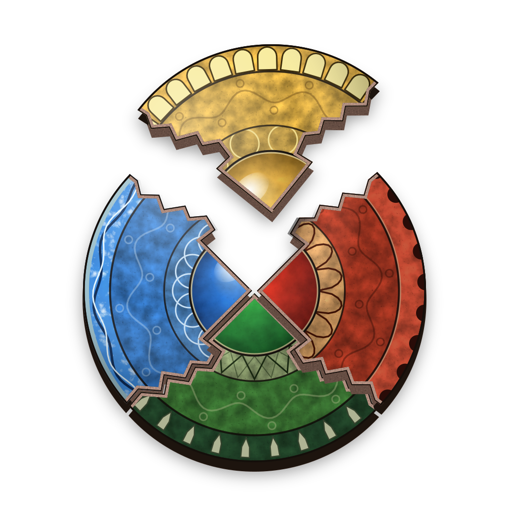

# AzurKit

AzurKit mods *Azurik: Rise of Perathia* (Xbox): patch packs and sliders, a randomizer with an item tracker, and
almost any creature to play as. It builds a new image from your own copy of the game, for you to play in xemu.

[Open it in your browser](https://azurik-modding-hub.github.io/AzurKit/) or
[download the app](https://github.com/Azurik-Modding-Hub/AzurKit/releases) for Apple Silicon Macs, Windows or Linux.

## What you need

- **Your own copy of the game,** USA or Europe, as an ISO image. AzurKit builds on your computer, and your image
  never leaves it.
- **[xemu](https://xemu.app),** the Xbox emulator, to play what you build.

AzurKit itself ships only the game's original config.xbr and pictures drawn from the game's files.

## Use it

- **In your browser:** nothing to install, and it works offline once loaded.
- **The app:** the same page in its own window. The apps are unsigned: on a Mac, open it, then choose Open Anyway
  in System Settings › Privacy & Security; on Windows, choose More info › Run anyway.
- **The command line:** `uv tool install azurkit`, then `azurkit --help`.
- **Play:** open the image you built in xemu.

## Features

- **Patches and sliders:** 60 FPS, gravity, movement, health, enemy scaling, a save-point warp, photo mode, fewer
  popups and crash fixes.
- **Randomizer:** shuffle disc fragments, powers, upgrades, gems, obsidians and fuel across all 22 levels, at the
  difficulty you pick, with a spoiler log.
- **Item tracker and maps:** what you've collected and can reach, on every level's map; in the app, Play starts
  xemu and Live marks your pickups as you play.
- **Characters:** play as 178 of the game's 184 creatures, or make your own variants.
- **Community content:** character variants from Azurik-Custom-Content or any https content repository.
- **Data:** edit every critter's, item's, armor's and spell's numbers.
- **Tools:** check your image, extract or replace a file, or edit and re-sign a save.
- **Sharing:** Copy link shares your setup, never your image.

Every feature in detail: [the guide](https://github.com/Azurik-Modding-Hub/AzurKit/blob/main/docs/GUIDE.md).

## Help

Ask a question or report a bug in [Issues](https://github.com/Azurik-Modding-Hub/AzurKit/issues), with AzurKit's
version (the About tab shows it). Never attach your game image.

Contributing: [docs/DEVELOPMENT.md](https://github.com/Azurik-Modding-Hub/AzurKit/blob/main/docs/DEVELOPMENT.md).

## Licence and credits

MIT ([`LICENSE`](https://github.com/Azurik-Modding-Hub/AzurKit/blob/main/LICENSE)) for our own work; the game's
files belong to its rights holders. [`NOTICE.md`](https://github.com/Azurik-Modding-Hub/AzurKit/blob/main/NOTICE.md)
holds the third-party licences. Thanks to Jett Tripp (JTCPP), whose randomizer is where AzurKit's forerunner began,
and to Azurik Perathia's Azurik Debug Menu, the photo mode's design.

*Unofficial fan tool. Not affiliated with or endorsed by the rights holders of Azurik: Rise of Perathia or Xbox.*
